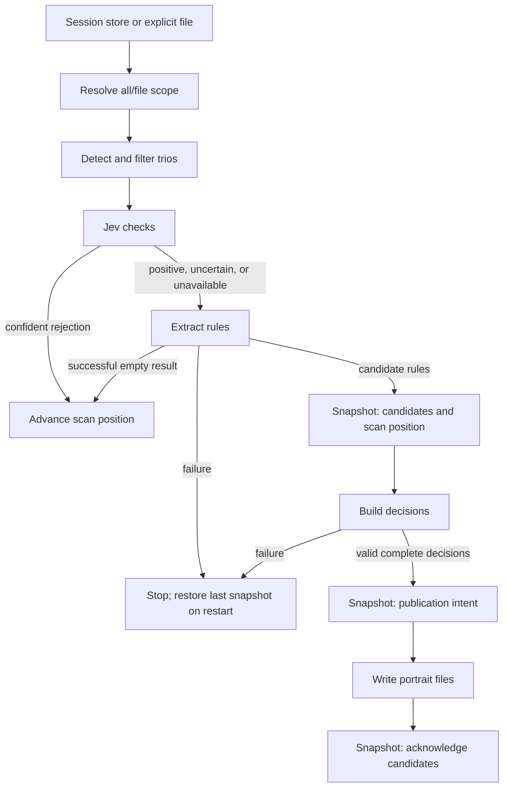

# pi-session-compass — Architecture Specification

Revision: **0.1.0** · Status: **Draft for review** · Date: **2026-10-11 PDT**

Companion: [Development plan](plan.md)

Project orientation, upstream attribution, and run-type limits: [compass.md](compass.md). Session continuation: [stage.md](stage.md).

## 1. Purpose and scope

Reduce the time and model cost of collecting useful behavioral rules from Pi sessions. Preserve the existing extractor’s responsibility for writing rules and the builder’s responsibility for inserting, merging, ranking, or skipping them. Put a Jev decision gate before extraction, with code controlling routing and side effects.

The proposed implementation also repairs failure handling directly on this path: failed extraction must not count as successful empty extraction, and extracted candidates must survive builder failure or process restart. These are source-review findings, not observed incidents in the supplied session.

Working scope assumption: Portrait continues to collect broadly reusable behavioral guidance. Project-specific instructions can be passed by the gate, but the extractor still decides whether they justify a general rule. This assumption has not received a separate user decision.

Required outcomes:

- Fewer generative extraction requests for interactions without behavioral lessons.
- Conservative handling of corrections, preferences, workflow steering, and confusion.
- Measured quality and cost before rejection is enabled.
- Recoverable scan and build progress through snapshot-and-restore, without silently losing candidates.
- Bounded runs even when useful rules are rare, with finite limits the user confirms before every live run.
- Explicit session-file selection, with isolated test output and no fallback to a wider scope.

Excluded from this change: a search index, BM25, vector storage, model training, a new agent framework, parallel extraction/building, and a broader session-analytics product. Builder batching across trios is a later optimization. No speedup target is promised.

## 2. Evidence and current behavior

Review inputs: the Oct 11 session bridge; supplied pipeline image; `avtc-pi-portrait-src.tar.gz`; `avtc-pi-portrait-settings.json`; and the supplied July 18 Pi session JSONL. The archive contains `src/` but no package manifest, lockfile, scripts, or tests. Portrait 1.1.1 and Pi 1.1.0 are reported in the bridge, not independently established by package metadata.

| Source finding | Consequence |
|---|---|
| `getSessionDirs()` hardcodes `~/.pi/agent/sessions`; discovery enumerates every project subfolder without a cwd selector. | Existing commands/settings cannot select one file. File selection must be added. |
| `TrioDetector` produces assistant → user → assistant text sequences and applies deterministic exclusions. | Reuse this definition initially; verify restart boundaries separately. |
| The pipeline calls `scanSessions(..., 100, 1)`. | A result is a productive trio, not an examined trio. `/portrait:collect N` cannot bound extraction cost. |
| Default `buildingBatchSize` is 1; batching slices candidate strings. | One trio producing three rules can cause three builder calls. The setting description incorrectly calls these trios. |
| Scan checkpoints are saved before building; candidates remain in memory. | Failed building or an interrupted run can lose pending work. |
| Failed extraction can become an empty rule list. | Failure and successful emptiness need distinct typed outcomes. |
| The retry loop uses `attempt < settings.retries`. | `retries: 0` currently makes zero attempts despite the documented meaning. |
| Four successful return tools omit `terminate`. | Check the installed core contract, then end successful return-tool calls without an unnecessary follow-up model request. |
| Current extraction dumps do not establish every model-request boundary. | Add request-level instrumentation before claiming termination savings. |

The supplied settings override extraction/building and maintenance models to `meta/muse-spark-1.3-contributor`, with thinking level `high`. Source defaults imply manual collection, post-extraction review off, five-second cooldowns before and after building, and debug dumps off. Defaults remain an inference until checked in the installed settings runtime.

The sample contains 28 user messages. A reproduction of the detector’s rules yields 26 eligible trios; this is not a live plugin or Jev result. A single session is a seed fixture, not a representative quality benchmark.

## 3. Proposed flow and ownership



| Component | Responsibility |
|---|---|
| Source selector | Freeze validated input scope and selected files; share it with scanning, counters, and receipts. |
| Scanner/detector | Read selected complete JSONL records; identify trios and safe trio-boundary scan positions. |
| Deterministic filter | Exclude existing framework messages and unambiguous acknowledgments. |
| Jev adapter | Submit typed checks; validate the transport response; return probabilities or a bypass reason. |
| Controller | Own mode, threshold, limits, retry policy, cancellation, and routing. |
| Existing generative extractor | Produce single-line candidate rules; decide their abstraction and usefulness. |
| Builder | Produce one insert/merge/skip decision per candidate against the current portrait. |
| Snapshot/restore layer | Save snapshots, restore the last one on restart, and publish validated results. |

Maintain the existing collection mutex. Collection, maintenance, reset, migration, and restore must all hold this same mutex before changing shared portrait or snapshot files. The instance lock is not a substitute for the mutation lock. This change does not introduce internal worker concurrency.

### Source selection and output contract

Use one run-level selection object: `sessionStoreRoot`, `scope`, an optional file target, and an independently resolved `portraitOutputDir`. `scope` is `all` or `file`. `all` is the default and keeps today’s behavior: every discoverable project session under the selected store, subject to the existing modification-age filter, with the default store `~/.pi/agent/sessions`. `file` requires an explicit JSONL path and selects that file only, independent of the age filter; it suits frozen fixtures. An explicit store root supports custom Pi session locations; the plugin must not claim to follow Pi's session-directory overrides automatically until verified. Invalid targets, conflicting options, or unreadable explicit files stop selection. Never fall back to a wider scope.

Resolve once at run entry and share an immutable selected-file list with extraction, the background trio counter, progress displays, and receipt generation. List selected paths/session IDs before any model request and record the selector plus file hashes in baseline manifests. Scope changes take effect on the next run. Cache advisory counts by selector identity so counts from another selection cannot leak into the display.

Top-level directories are fixed in project-init.md: harness code in `scripts/`, frozen inputs in `fixtures/`, and each run’s output in its own subdirectory of `outputs/`. Output is separate from input scope. Normal collection retains the global portrait unless a different output directory is explicitly selected. Every Stage 1 fixture run requires an isolated output directory covering portrait/archive files, snapshots, locks, and diagnostics; redirecting only session input is insufficient.

Scan positions stay keyed by source identity within the output store. Store the normalized source path and header cwd with pending candidates. In file mode, drain only pending candidates whose stored source matches the selected file and leave others pending. If legacy entries lack source metadata, report them rather than guess. Automatic output-wide maintenance is deferred during file-mode collection; explicit maintenance remains a separate operation. `all` collection retains its existing maintenance trigger.

Stage 1 implements and verifies a runnable file-selection entry point in the harness before any live measurement; the capability is currently planned, not implemented. The user can supply any accessible session JSONL. Offline synthetic checks come first, then request instrumentation, limit and confirmation verification, then the live `smoke` run (confirms the harness runs and shows sample output), then the `baseline` run (the measurement). Extraction/building semantics remain unchanged for the baseline.

Deferred and outside the current plan: workspace scope (exact session-header cwd match), public selection controls in user settings, and workspace-based pending-candidate eligibility. The `scope` field and the source path/cwd stored with pending candidates are the seams that make them additive; adding them changes the selector and no stored format.

## 4. Jev contract

### Input and transport

Use TypeSafe direct: `POST https://api.typesafe.ai/v1/systemone`, JSON with `model`, `state`, and `questions`; authenticate with a Bearer key supplied through `TYPESAFE_API_KEY`. Do not put the credential in settings, prompts, journals, or diagnostics. Select direct HTTP with bounded timeout/backoff to keep the adapter small; no SDK dependency is required.

Pin `jev-1.13.0` for the initial evaluation and activation, subject to account availability. Record the model ID returned by the service. A changed model, question policy, or threshold invalidates the activation evidence. Keep the request body in Jev’s wire format, but isolate transport/auth so another provider can have its own adapter later; wire compatibility with OpenRouter or a local server is not assumed. [J1, J2]

The state is a text-only object:

```json
{
  "agentBefore": "Assistant text before the user's intervention",
  "userFeedback": "The user's intervention",
  "agentAfter": "Assistant text after the intervention"
}
```

Use the current trio’s text, not the entire session, tool-output history, or portrait. Preserve short feedback and negation. Remove only reliably identified framework wrappers; do not summarize, truncate, or remove pasted content in a way that might erase a lesson. If the serialized gate state exceeds the configurable local input bound, bypass Jev and extract from the original trio. The initial local bound is 32 KiB of UTF-8 state, a conservative application cap, not a claim about model token limits. Provider context errors also bypass the gate. [J3, J6]

### Questions and routing

Send four Noul questions in one request. Noul returns `noul` in [0, 1], with no separate `confidence`. These checks may overlap; their probabilities must not be multiplied or presented as a calibrated probability of the combined decision. [J4, J5]

| Question ID | Instruction intent | Positive boundary |
|---|---|---|
| `correction` | Does `userFeedback` correct or challenge something the agent said or did, given the surrounding messages? | Wrong assumptions, missed concerns, inaccurate claims, or unwanted action. |
| `preference` | Does `userFeedback` express a preference about how the agent should communicate or work? | Style, explanation depth, scope, process, or priorities; distinguish task content from working preference. |
| `steering` | Does `userFeedback` redirect the agent’s approach to the work? | Change the method, sequence, structure, or decision framing. |
| `confusion` | Does `userFeedback` indicate difficulty following the agent’s explanation or progress? | “I’m lost,” unnecessary scrolling, missing orientation, or unclear next action. |

The implementation must supply full instructions and aligned true/false criteria. Question IDs are response keys, not instructions. Treat session text as evidence to classify, not instructions to execute. Include mixed task/preference requests, ambiguous “no,” and short corrections in evaluation. [J1, J4, J6]

Initial routing proposal: reject only when **all four probabilities are ≤ 0.10**. Otherwise pass to extraction. This is an unvalidated starting threshold, not an approved operating point. An error, missing key, missing answer, wrong type, non-finite/out-of-range probability, timeout, or oversized state produces a bypass to extraction. Every expected question must be present and valid before rejection is permitted.

Modes:

- **Off:** existing extraction path, with recovery repairs active.
- **Shadow:** call Jev and record what it would do, but extract every eligible trio.
- **Enforce:** reject only under the validated policy above.

Ship with mode off; evaluation explicitly selects shadow. Missing authentication disables gate calls for the run and reports one concise diagnostic. Use a five-second total gate deadline, at most one retry for transient transport/429/529 failures, and backoff respecting `Retry-After` within that deadline. Do not retry authentication or request-validation failures. After three consecutive gate failures, bypass the gate for the rest of that run. The run’s request limit still applies when the gate fails open.

### Candidate meaning

A candidate is a proposed rule string, not a retrieved passage or a Jev output. Example from the supplied session: “Preserve the original artifact before editing so changes can be compared.” This is an illustrative human interpretation; it has not been produced by a model run. The builder decides insert, merge, or skip. Jev does not write the sentence. [J6]

## 5. Extraction, termination, and execution limits

Introduce explicit extraction outcomes: `success` with zero or more rules, `failed` with diagnostics, and `paused/cancelled`. Only a successful empty result is eligible to advance the scan position without pending candidates. Validate candidate text as nonempty, single-line strings.

Add `terminate: true` only to successful captures in `return_extraction`, `return_post_extraction`, `return_building`, and `return_maintenance`, after verifying the installed core types and loop. Keep repairable tool-input errors nonterminal. Reset captured output for every attempt/validation cycle so an earlier capture cannot masquerade as a later successful result. Correct retries to mean one initial attempt plus the configured number of retries; preserve the existing maximum of three builder validation rounds. All actual model requests in every round count toward the run limit.

Keep the reviewed upstream `/portrait:collect N` semantics as a productive-trio target. Add separate controller limits for total actual model requests and elapsed run time.

### Run-type limits and confirmation

Limits are per-run settings, not design constants. Every live run has a declared run type (`smoke`, `baseline`, `compare`, `evaluate`, or `collect`) and finite limits `maxModelRequests` and `maxRunMs`. The [compass.md](compass.md) run-type table holds stored defaults that serve as suggestions; the initial `smoke` row is **5 model requests and 900,000 ms (15 minutes)**, and the other rows start UNSET. There is no unlimited mode.

- Limits reach the code as required harness switches: `--run-type`, `--max-model-requests`, and `--max-run-ms`. The harness has no built-in defaults and refuses to start without them. It accepts only finite positive integers.
- The suggested value is the run type’s compass.md row if set; if the row is UNSET, the agent suggests values from the trio count and states its basis and assumptions.
- After the free offline selection and trio count, and before any model request, the harness shows the run type, limits, selected file with its eligible trio count, and output directory, and requires confirmation. The user accepts the suggestion, enters their own values for that run, or cancels; cancelling makes no model call. The prompt also states that each eligible trio needs at least one extraction request (a source-review lower bound, unmeasured), that the limits cap requests and wall-clock time and not spend, that extraction runs at high thinking so token cost is unknown until the provider reports usage, and that a capped run stops partway and is incomplete.
- On a terminal the harness asks interactively. When launched by an agent it refuses to run unless `--confirmed` is passed, and the agent passes that only after the user approves the displayed values in the session. This is enforced by the operating rules, not by the harness, which cannot tell who passed the flag. Unattended or scheduled runs cannot start.
- Every manifest and receipt records the run type, the suggested values, the final values, and their source (compass.md row, agent suggestion, or user override). The compass.md table changes only when the user asks.
- A capped `smoke` run whose harness checks passed is a successful smoke result with no measurement claims. A capped run of any other type is incomplete.
- Counting is unchanged: every inference request across Jev, extraction, post-review, building, and maintenance, including failed attempts, retries, and tool-follow-up turns. Retries inside the provider layer count too, or the undercount is recorded (S1.T3.1). Several Jev questions in one HTTP request count once; local tool execution and offline mocks do not count. The run deadline is wall-clock time and includes cooldowns. An optional examined-trio cap remains separate from these limits.

Verify the selector, isolated output, request counter, deadline, and confirmation controls offline before making a live request. Check capacity before every model request, including Jev, follow-up turns, retries, post-extraction, and automatic maintenance. Abort at the run deadline. If the limit is reached before extraction completes, the scan position stays at the last snapshot; if it is reached before building, pending candidates stay in the snapshot. Budget/cancellation checks must run inside scanning, not only after a productive result returns. Do not silently change cooldown, thinking level, or extractor model while benchmarking the gate. The `smoke` row is a harness check, not a promise to complete a whole session or a statistically useful benchmark. Report LIMIT_REACHED; outside `smoke`, leave unfinished task/stage checkboxes unchecked and preserve partial evidence without claiming M1 or silently restarting.

## 6. Durable work: snapshot and restore

An interruption or a failed call must not lose pending candidates or leave the portrait half-written. The design prefers simple rollback over exact mid-step continuity: restore the last snapshot and redo what followed it. Redone steps may cost extra model calls, and the redone output may differ from the first attempt; both are accepted. This application does not need fine-grained state recovery.

### Snapshot

A snapshot directory under the output directory holds a schema version, `state.json`, and copies of the portrait and archive files. `state.json` holds:

- per-source scan positions (see below);
- pending candidates: stable trio ID, normalized source path and header cwd, source session and entry IDs, extraction-policy revision, candidate strings, and stage (`needsPostReview` or `needsBuild`);
- at most one publication intent: the intended digest of each portrait/archive file about to be written.

Each snapshot is written beside the previous one, flushed to disk, then switched in; at startup the newest complete snapshot is used. A corrupt or unsupported snapshot stops processing with diagnostics and is never treated as empty. Keep a recoverable migration backup.

Trio IDs derive from the session header ID and the entry IDs of the trio’s records (or a hash of the trio’s own records), never from a whole-file hash: session files grow by appending, so a whole-file hash would change every ID. Candidate IDs derive from the trio ID and ordinal. No full history copy is required. Retain only bounded diagnostic metadata after completion.

If optional post-extraction review is enabled, persist raw rules first as `needsPostReview`. Successful review replaces them with final rules or completes the job as intentionally dropped; review failure retains the raw rules. The supplied configuration keeps this stage disabled.

### Snapshot boundaries

1. After a trio’s candidates are saved together with the new scan position, in one snapshot. This removes the gap between “candidate saved” and “scanner advanced.” A successful empty extraction advances the scan position the same way without candidates; a failed extraction advances nothing.
2. After the builder’s decisions are validated and the intended digests of the files to write are recorded, before any portrait file is written.
3. After publication completes and the candidates are acknowledged.

### Scan position

The scan position is saved only at a trio boundary: the start offset of the trio’s closing assistant record, so the next scan can reconstruct the assistant message before the next user turn. Use byte offsets, read only complete newline-terminated records, and at EOF preserve the context needed for a pending user turn or a later appended user message. Verify source identity and a stored boundary digest before resuming; truncation or a rewritten source requires an explicit rescan decision.

Filtered user turns and successful gate rejections advance the position only to a boundary that retains the detector context needed afterward. A malformed complete record stops that file with diagnostics; parsing exceptions must not swallow extraction or snapshot failures. Test restart equivalence on adjacent trios, approval turns, Unicode, partial tails, and appended records. This addresses a source-level restart risk; it does not assume historical scans were complete.

### Publishing a build

Separate builder decisions from file writes. Validate exactly one recognized action for every submitted candidate; reject duplicate, unknown, or missing candidate IDs, bad references, and conflicting operations before mutation. Compute the final file contents without writing them, record their digests (snapshot boundary 2), then, under the collection mutex, atomically replace each affected file. Attempt the existing optional Git commit; record failure without repeating the semantic build, and never discard candidates because of it. Then take snapshot boundary 3. A valid all-skip batch completes without file writes.

### Restore on restart

Under the collection mutex, before scanning, building, maintenance, or reset:

1. Select the newest complete snapshot.
2. Edit guard, per file: the current portrait/archive file must equal the snapshot’s copy or the recorded intended digest. Otherwise stop and report a conflict; do not overwrite external edits or unknown state.
3. If every file passes, restore the snapshot’s files and state, then redo what followed: re-extract trios after the scan position, and re-run the builder for pending candidates.

| Interrupted point | Result |
|---|---|
| Before extraction succeeds | The trio after the last snapshot is extracted again. |
| After boundary 1 | Resume from the pending candidates and build; no re-extraction. |
| After boundary 2, before or during file writes | Per-file guard passes; the snapshot’s files are restored and the builder runs again. |
| After the file writes, before boundary 3 | Same: the files are restored to the snapshot copies and the build is redone, so the same rules are not inserted twice. |
| Invalid builder result or exhausted retries | Candidates stay pending; the run stops with diagnostics. |

In file mode, pending candidates from other sources stay pending and untouched.

### Migration and reset

On first use, back up existing state and import old offsets once. Reconstruct the preceding assistant context and retain a legacy cutoff so previously committed user records are not automatically re-extracted. If the source is missing or no valid boundary can be established, retain the legacy entry and report it instead of guessing. Importing offsets cannot recover already lost work or prove prior completeness. Preserve the existing portrait; do not automatically reset or re-extract history. Offer an explicit rescan option for a selected corpus if the owner wants completeness checked. Background progress counters are advisory and must use the new scan-position authority without writing progress.

Keep existing portrait/archive filenames and formatting. Include the snapshot in the existing reset confirmation, hold the collection mutex, and clear snapshot state as part of the reset protocol. Old byte-checkpoint files become migration inputs, not a second live authority. Do not mutate state while downgrading to an unmodified older plugin; restore the migration backup only after preserving pending candidates.

## 7. Evidence, quality, and activation

Use small run receipts: run/settings/source revisions, run type and the suggested and final limits with their source, selected store/scope/target/files/output directory, mode, question-policy hash, requested/resolved models, source trio references, gate values and bypass reasons, examined/productive/rejected counts, actual requests per stage, usage where reported, elapsed time, failures, and stop reason. Credentials and full transcripts are excluded. Mark unavailable provider usage as unknown rather than zero. Debug text remains opt-in; receipts support this optimization, not a new analytics system.

Two readable outputs come from the same traces. The smoke results sheet has one entry per examined trio: trio reference, extractor output (candidate rules or none), builder decision if reached, and portrait diff; it shows samples and makes no quality claim. The baseline running table gives, per trio, trios examined so far, cumulative productive rate, cumulative candidates, insert/merge/skip counts, and portrait size.

First measure the existing pipeline, then the termination/retry repair, then shadow Jev. Evaluate identical immutable trios, model settings, initial portrait, and relevant cooldowns. Distinguish extraction-call reduction from total cost/latency, which also includes Jev, building, retries, and maintenance. Live model outputs can vary; archive the observed outputs with the evaluation record. Report only what a run covered: do not extrapolate a capped run to uncovered trios or use such a projection as a savings denominator.

The seed fixture supplies examples for policy development. Expand to a frozen evaluation set with useful interactions, ordinary requests, ambiguous refusals, mixed requests/preferences, and short corrections from other sessions. Record human judgments of whether each trio contains a potential reusable lesson. Tune on a development split; keep a held-out split for activation.

Proposed activation criteria: zero missed labeled corrections in the held-out set; at least 95% of human-labeled useful trios retained; measured total cost lower than the repaired ungated baseline; and all restore tests passing. Set minimum sample sizes before tuning: zero misses in n labeled cases supports only a miss rate of about 3/n at 95% confidence (rule of three), so bounding the miss rate at 5% needs about 60 labeled positives, and 1% about 300. Report numerators, denominators, the resulting bound, and limitations. These are proposal values requiring review, not established guarantees. Compare with extractor positives as an additional measure, not the sole definition of truth.

Separately audit a uniform random sample of up to 200 predicted rejections, or all if fewer. Report useful lessons found among rejected trios; this measures rejection quality, not recall by itself. Include the cost of shadow extraction and labeling in the evaluation budget; labeling effort is not yet estimated. If the available corpus is too small or too narrow, remain in shadow mode and label the result preliminary.

## 8. Session continuation and verification dependencies

Use [stage.md](stage.md) as the continuation index and each `stage-N-task.md` as execution detail. One session targets one stage. At startup, AGENTS.md instructs Pi to read the index and first unfinished stage task; other documents are read only as needed. At exit, update task checkboxes, stage status, next unfinished task, blockers, and evidence references. Check a stage only after its milestone is verified. If interrupted or blocked, the next session resumes that stage. If its task file is absent, report the missing file and stop; do not invent execution instructions or skip ahead. Finishing a stage ends that session’s work. A user instruction to continue in a new session selects the next unfinished stage. Stage 2 ends with a user decision (raise the limit and rerun, proceed to S3, or stop) before Stage 3 starts.

### Verification dependencies and decisions for review

| Item | Status / implementation handling |
|---|---|
| Broad-rule scope | Working assumption; preserve current extraction intent. |
| Durability repair | Stage 3, sequenced after the S1–S2 foundation at user direction, as snapshot-and-restore. The design is approved in outline; details remain for review. |
| Source scope and output | File selection plus isolated output in Stage 1; `all` unchanged as default. Workspace scope and public selection controls are deferred, with seams recorded in §3. |
| Exact installed Pi/core/package versions | Obtain manifest/lockfile or dependency report in baseline task. |
| Pi launch syntax and AGENTS.md auto-loading | Inherited from earlier drafts, unverified; checked in S1.T1. |
| `terminate` support and saved requests | Verify at request boundaries before claiming savings. |
| Provider-level retries below the counted boundary | Unknown; determined in S1.T3.1 and cross-checked against provider-side usage in the smoke test. |
| TypeSafe credential/account availability | Configure locally during implementation; no key supplied here. |
| Gate questions, threshold, and input cap | Proposals; validate before enforce mode. A fifth question for durable explicit directives and positive reinforcement was proposed and is not in this design. |
| Live-run limits | Run-type table in compass.md; `smoke` is set (5 requests, 15 minutes), the other rows are UNSET suggestions. Every live run takes switches and user confirmation. Implement and verify before any live run. |
| Census, productive rate, and workbook assumptions | Still unmeasured; do not adopt the bridge’s illustrative 4× as a requirement. The Stage 1 census is used to suggest limits. |
| `<!-- approved -->` markers | Part of upstream’s Text Review convention in its AGENTS.md; no runtime meaning is assumed. Leave existing markers; changes to protected text follow that rule. |

## 9. Source references

Project evidence is the supplied archive and attachments, not a running installation. Code references are relative to the archive’s `src/`: `collector.ts`, `trio-detector.ts`, `pipeline.ts`, `llm-call.ts`, `builder.ts`, `maintenance-core.ts`, `storage.ts`, `schema.ts`, `config.ts`, `index.ts`, and command modules.

Official Jev documentation: the API reference, models and version-pinning, and Noul pages were rechecked October 11, 2026 (endpoint, bearer auth, request fields, the `noul` range with no separate confidence, `jev-1.13.0`, the 401/422/429/529 errors); the state, limitations, and workflow pages were not rechecked.

- **J1:** [API reference](https://docs.typesafe.ai/api)
- **J2:** [Models and version pinning](https://docs.typesafe.ai/models)
- **J3:** [State](https://docs.typesafe.ai/concepts/state)
- **J4:** [Primitives](https://docs.typesafe.ai/primitives)
- **J5:** [Noul](https://docs.typesafe.ai/primitives/noul)
- **J6:** [Jev 1.13 limitations](https://docs.typesafe.ai/model-jaggedness/jev-1.13)
- **J7:** [Code-owned workflows](https://docs.typesafe.ai/concepts/how-to-build-with-system-one)

## Revision history

| Revision | Date | Change |
|---|---|---|
| 0.1.0 | 2026-10-11 | Initial committed draft. |
